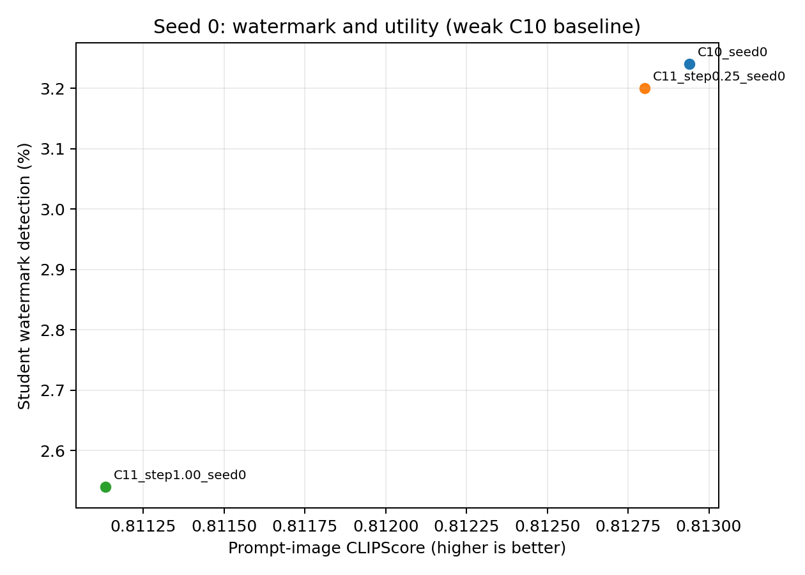

# Báo cáo thực nghiệm: output laundering trước downstream adaptation

> **Cập nhật sau audit code ngày 11/10:** Đã xác nhận lỗi gradient clipping trong Diffusers dùng để train cả sáu student: iterator tham số bị optimizer duyệt hết trước bước clipping. Đã sửa cho run tương lai; số liệu dưới đây vẫn là kết quả trước sửa. Chưa xác định lỗi này ảnh hưởng TPR bao nhiêu. Xem [audit C10](C10_CODE_AUDIT_2026-10-11.md); phát biểu bên dưới rằng chưa tìm được lỗi đủ giải thích khoảng cách không có nghĩa code không có lỗi.

**Ngày:** 11/10/2026. **Phạm vi:** SERUM–SD2.1 → CtrlRegen+ → SD1.4 LoRA; một adaptation seed (`seed=0`). Core queue hoàn thành lúc 10:18, giờ Việt Nam. Báo cáo đối chiếu [threat-model plan](../THREAT_MODEL_radioactive_watermark_laundering.md), không thay đổi tiêu chí thành công của plan.

## 1. Kết luận thực nghiệm

CtrlRegen+ giữ được khả năng phát hiện watermark ở mức ảnh: TPR trên pilot watermarked đạt 99,4–100%. Sau downstream adaptation, mức strong giảm tỷ lệ phát hiện từ **3,24% xuống 2,54%**, tức **0,70 điểm phần trăm** hay **21,6% tương đối**; CI bootstrap 95% của chênh lệch là **[0,22; 1,20] điểm phần trăm**. Mức mild không cho thấy hiệu ứng rõ ràng.

Utility đo được không suy giảm lớn: strong làm CLIPScore của C11 giảm khoảng 0,22% so với C10, trong khi KID/FID so với phân phối teacher clean cải thiện. Tuy nhiên, đây chưa phải chứng minh tương đương utility, chuyển giao năng lực đặc thù, hoặc thành công ổn định của attack.

**Kết quả được phân loại là tín hiệu thăm dò, chưa đạt baseline gate và success gate của plan.** C10 chỉ đạt 3,24%, thấp hơn nhiều so với mức 52,30% được dẫn trong plan từ SERUM. Không thể dùng việc C11 nằm trong khoảng 1–5% để tuyên bố strong success khi C10 vốn đã gần vùng này. Chưa chạy đủ ba adaptation seed, phân tích cơ chế hoặc defense.

## 2. Thiết kế và quy trình

| Thành phần | Cấu hình thực nghiệm |
|---|---|
| Teacher | SD2.1 Base, mirror `sd-research/stable-diffusion-2-1-base`, revision `0708cecd370b4d1c3a6ff3f7332f5e9aea78896f` |
| Watermark | SERUM, alpha = 0,5; watermark/detector huấn luyện tại chỗ, sau đó đóng băng |
| Student | `CompVis/stable-diffusion-v1-4`; cùng khởi tạo cho mọi condition |
| Adaptation | LoRA rank 4, LR 10⁻⁵, batch 8, 20.000 step, seed 0; text encoder đóng băng |
| Chọn checkpoint | Minimum denoising MSE trên 1.000 ảnh validation của condition tương ứng; không dùng SERUM TPR |
| Sinh ảnh student | 512×512, PNDM, 50 inference step, CFG 7,5; cùng prompt ID và seed `50000 + index` |
| Laundering | Public CtrlRegen+; Realistic Vision V4 noVAE, semantic và Canny conditioning, color matching; 50 step, CFG 2,0 |
| Prompt tái sinh | Prompt cố định của public demo; caption huấn luyện student vẫn là prompt gốc |
| Audit | Một detector và threshold cố định; không recalibrate theo condition |

Bốn prompt split tách biệt: adaptation train 5.000, adaptation validation 1.000, student evaluation 5.000 và detector calibration 5.000. Bộ teacher ban đầu có **22.000 ảnh**: clean/watermarked train 5.000 mỗi loại, clean/watermarked validation 1.000 mỗi loại, clean calibration 5.000 và watermarked calibration 5.000 chưa dùng. Không phải toàn bộ 22.000 ảnh đều dùng để huấn luyện student.

Core gồm sáu student: C00 và C10 raw dùng chung cho hai mức; C01/C11 được huấn luyện riêng ở mild và strong. Mỗi student sinh 5.000 ảnh evaluation, tổng **30.000 ảnh**. Tái sinh đầy đủ clean/watermarked train và validation ở hai mức tạo **24.000 ảnh**. Reference utility là 5.000 ảnh teacher clean trên `student_eval`, không đưa vào train hoặc chọn checkpoint.

Audit dữ liệu đã kiểm tra số lượng, khả năng decode RGB 512×512, hash shard–merged, pairing filename/prompt và tính tách biệt của split. C00/C01 và C10/C11 giữ cùng source ID. Việc kiểm tra tự động không thay thế yêu cầu kiểm tra trực quan ít nhất 50 cặp prompt–image; báo cáo này chưa có biên bản xác nhận riêng cho mục đó.

## 3. Detector calibration và teacher baseline

Threshold đóng băng là **τ = 0,04637297987937927**, với 50/5.000 false positive trên clean calibration, tương ứng FPR thực nghiệm 1%. Tỷ lệ trên các tập clean khác có thể khác 1%; không ép mỗi condition về đúng 1%.

| Tập đánh giá | Positive / n | Tỷ lệ |
|---|---:|---:|
| Clean calibration | 50 / 5.000 | 1,00% |
| Teacher clean train | 63 / 5.000 | 1,26% |
| Teacher watermarked train | 4.999 / 5.000 | 99,98% |
| SD1.4 chưa adaptation | 48 / 5.000 | 0,96% |

Teacher image ROC-AUC = **0,99999528**. Kết quả xác nhận detector nhận diện tốt watermark trên ảnh teacher trong cấu hình tại chỗ. Điều này không bảo đảm detector có độ nhạy giống artifact gốc đối với tín hiệu yếu đã chuyển qua student.

## 4. Pilot và lựa chọn strength

Pilot dùng 500 ảnh clean và 500 ảnh watermarked, mỗi nhóm chạy bốn strength. Các giá trị similarity dưới đây là trung bình trên **500 ảnh watermarked**; clean control được đánh giá song song.

| Strength | WM image TPR | Clean image FPR | CLIP image cosine ↑ | DINOv2 cosine ↑ | LPIPS ↓ | Giữ prompt CLIPScore |
|---|---:|---:|---:|---:|---:|---:|
| Raw | 100,0% | 0,4% | — | — | — | 100% |
| 0,25 | 100,0% | 0,2% | 0,97314 | 0,95753 | 0,10667 | 98,20% |
| 0,50 | 100,0% | 0,2% | 0,95929 | 0,93828 | 0,16128 | 97,35% |
| 0,75 | 99,6% | 0,2% | 0,94745 | 0,92446 | 0,20480 | 96,85% |
| 1,00 | 99,4% | 0,4% | 0,93751 | 0,91365 | 0,24414 | 96,37% |

Policy chọn strength yêu cầu cả clean và watermarked đạt CLIP cosine ≥ 0,85, DINO cosine ≥ 0,80, LPIPS ≤ 0,40 và prompt CLIPScore retention ≥ 95%. Đây là tiêu chí vận hành đặt trước pilot, không phải ngưỡng quy định bởi paper. Mọi candidate đều đạt.

**Mild = 0,25** tối đa hóa mức bảo toàn `CLIP + DINO − LPIPS` trong các mức thấp hợp lệ; **strong = 1,00** là strength lớn nhất vẫn đạt policy. Detector score không tham gia chọn strength. Pilot CLIPScore dùng CLIP ViT-L/14, còn student utility dùng ViT-B/32; không so trực tiếp trị tuyệt đối giữa hai bảng.

## 5. Kết quả core seed 0

### 5.1. Radioactive transfer

Trong bảng, tỷ lệ ở C00/C01 là false-positive rate trên clean-trained student; ở C10/C11 là tỷ lệ phát hiện trên WM-trained student, dùng làm TPR vận hành của thí nghiệm. Mỗi condition có n = 5.000. CI là bootstrap 95%, 1.000 lần lấy mẫu.

| Condition | Strength | Positive | Tỷ lệ phát hiện | CI 95% | Checkpoint chọn | Best val MSE |
|---|---:|---:|---:|---:|---:|---:|
| C00 clean/raw | — | 46 | 0,92% | [0,68; 1,22]% | 20.000 | 0,149790 |
| C10 WM/raw | — | 162 | 3,24% | [2,74; 3,72]% | 20.000 | 0,146096 |
| C01 clean/regen | 0,25 | 48 | 0,96% | [0,72; 1,24]% | 20.000 | 0,144479 |
| C11 WM/regen | 0,25 | 160 | 3,20% | [2,72; 3,70]% | 20.000 | 0,141289 |
| C01 clean/regen | 1,00 | 41 | 0,82% | [0,58; 1,08]% | **19.500** | 0,146157 |
| C11 WM/regen | 1,00 | 127 | 2,54% | [2,10; 2,98]% | 20.000 | 0,143286 |

Validation MSE dùng ảnh của từng condition, nên khác biệt giữa các hàng không chứng minh student nào học cùng một mục tiêu tốt hơn. Checkpoint được chọn độc lập bằng MSE, không chọn theo watermark score.

### 5.2. Utility downstream

CLIPScore = `2,5 × max(cosine, 0)`, CLIP ViT-B/32. FID/KID so với **5.000 ảnh teacher clean SD2.1 trên cùng evaluation prompts**, đo độ gần phân phối teacher; không phải COCO FID. KID dùng 100 subset, mỗi subset 1.000 ảnh. `±` của KID là độ lệch chuẩn giữa subset, không phải CI giữa adaptation seed.

| Condition | CLIPScore ↑ | FID ↓ | KID × 10³ ↓ |
|---|---:|---:|---:|
| C00 | 0,812932 | 13,295 | 1,356 ± 0,207 |
| C10 | 0,812940 | 14,601 | 2,353 ± 0,268 |
| C01 mild | 0,810667 | 13,558 | 1,534 ± 0,262 |
| C11 mild | 0,812802 | 14,935 | 2,570 ± 0,279 |
| C01 strong | 0,807146 | 13,036 | 1,071 ± 0,179 |
| C11 strong | 0,811133 | 13,982 | 1,723 ± 0,211 |

Strong làm C11 CLIPScore giảm **0,001807**, khoảng **0,22%**, CI chênh lệch C11−C10 = [−0,003140; −0,000460]. C01 strong giảm **0,005786**, khoảng **0,71%**, so với C00; CI = [−0,007054; −0,004462]. Các giảm này nhỏ về trị tuyệt đối nhưng CI không chứa 0. Không diễn giải thành “utility không thay đổi”; chưa thực hiện kiểm định equivalence với biên định trước.

FID/KID strong thấp hơn raw tương ứng, không gợi ý sụp đổ phân phối theo các metric đã đo. FID chỉ dùng 5.000 ảnh, còn nhiễu mẫu; chưa đạt khuyến nghị 10.000 ảnh cho kết quả cuối cùng của plan.

### 5.3. Hiệu ứng ghép cặp và clean control

Đặt mức giảm TPR `r = TPR(C10) − TPR(C11)` và hiệu ứng đã trừ clean control:

`r_adjusted = [TPR(C10) − FPR(C00)] − [TPR(C11) − FPR(C01)]`.

| Strength | Giảm TPR | CI 95% | Giảm tương đối | r_adjusted | CI 95% của r_adjusted |
|---|---:|---:|---:|---:|---:|
| Mild | 0,04 điểm % | [−0,40; 0,46] | 1,23% | 0,08 điểm % | [−0,40; 0,56] |
| Strong | 0,70 điểm % | [0,22; 1,20] | 21,60% | 0,60 điểm % | [0,06; 1,16] |

Raw watermark excess trên clean control là 2,32 điểm %, mild là 2,24 và strong là 1,72. Strong giảm excess khoảng **25,9%**. Đây là đại lượng khác với giảm tương đối TPR 21,6%.

Theo đúng tương tác detector-score ở §5 của plan:

`Δ_launder = [mean D(C11) − mean D(C01)] − [mean D(C10) − mean D(C00)]`.

| Thiết lập | Mean score clean | Mean score WM | Median score clean | Median score WM | AUC WM vs clean |
|---|---:|---:|---:|---:|---:|
| Raw | 0,003883 | 0,013153 | 1,367×10⁻⁶ | 5,734×10⁻⁶ | 0,609889 |
| Mild | 0,002928 | 0,012156 | 1,471×10⁻⁶ | 5,696×10⁻⁶ | 0,600753 |
| Strong | 0,003059 | 0,009225 | 1,305×10⁻⁶ | 4,515×10⁻⁶ | 0,590394 |

Mild: Δ = **−0,0000418**, CI [−0,002093; 0,001946]. Strong: Δ = **−0,003104**, CI [−0,005399; −0,000774]. Hai cách đo đều hỗ trợ hiệu ứng giảm nhỏ ở strong trong seed này. AUC trên student so sánh WM-trained với clean-trained output, không đồng nhất với AUC teacher image ở §3. CI lấy mẫu trên các output/prompt đã sinh, không đo biến thiên do huấn luyện lại hoặc key khác.

Frontier có ba điểm raw/mild/strong, chưa phải sweep downstream liên tục. Strong giảm phát hiện kèm giảm nhẹ CLIPScore; không chi phối raw trên mọi utility metric.

## 6. Trả lời câu hỏi trong plan

| Câu hỏi | Trả lời dựa trên dữ liệu hiện có |
|---|---|
| Q1: CtrlRegen+ có xóa watermark trên ảnh không? | Không đáng kể trong pilot: WM TPR còn 99,4–100%. Kết luận chỉ cho cấu hình/checkpoint public đã dùng, không khẳng định đồng nhất với mọi cấu hình CtrlRegen trong paper. |
| Q2: Watermark có chuyển sang student khi train raw không? | Có tín hiệu yếu: C10 3,24% so với C00 0,92% và unadapted 0,96%; excess 2,32 điểm %. Chưa tái lập mức radioactivity mạnh của paper. |
| Q3: Laundering trước adaptation có giảm transfer mà giữ utility không? | Mild chưa có bằng chứng; strong giảm 0,70 điểm % với utility thay đổi nhỏ theo các metric đã đo. Chưa chứng minh mất phần lớn transfer hoặc thành công lặp lại. |
| RQ1: Image-level robustness có suy ra radioactive robustness không? | Kết quả phù hợp với khả năng hai thuộc tính khác nhau: image TPR cao vẫn đi kèm giảm nhỏ student TPR. Chưa đủ để kết luận sự “collapse” của radioactive transfer hoặc một quan hệ tổng quát. |
| RQ2: Transform key/detector-agnostic có hiệu quả không? | Strength được chọn bằng image-preservation metric, không dùng detector score. Có tín hiệu giảm ở strong; chưa đạt moderate success ≥ khoảng 50% và chưa có ba seed. |
| RQ3: Thuộc tính nào quyết định watermark còn learnable? | Chưa trả lời. Chưa phân tích hướng feature, phổ tần số hoặc tín hiệu student học được. Mean-score interaction âm không chứng minh cơ chế. |
| RQ4: Semantic entanglement phục hồi radioactivity được không? | Chưa kiểm nghiệm; defense gate chưa đạt. |
| Có thể gọi là model stealing không? | Chưa. Chưa dùng specialized teacher và chưa chứng minh năng lực teacher được chuyển sang student vượt base student. |
| Thuộc case thành công nào của §9–10? | Chưa đạt Case A/B; mild không thể hiện hiệu quả trong seed này, strong có giảm nhưng không collapse. Không có bằng chứng utility collapse kiểu Case C theo metric hiện tại; cũng chưa kết luận Case D cho mọi strength/seed. Tổng thể là weak/exploratory result vì baseline chưa tái lập. |
| Có động lực đủ để làm defense không? | Chưa: thiếu baseline mạnh, lặp seed và một operator/student bổ sung theo §27. |

## 7. Chênh lệch với kết quả SERUM và giới hạn

Mức **52,30%** là số được dẫn trong plan từ paper, không phải kết quả của pipeline này. C10 hiện thấp hơn **49,06 điểm phần trăm**. Audit chưa tìm được lỗi triển khai đủ giải thích khoảng cách; cũng chưa chứng minh pipeline khớp đầy đủ với artifact/recipe gốc. Không suy ra paper không đáng tin từ một lần tái lập chưa đầy đủ.

Những kiểm tra đã có: pairing đầy đủ 5.000 row C00/C10; đúng các hyperparameter chính; adapter có trọng số hữu hạn và làm thay đổi dự đoán UNet; không ghi nhận loss không hữu hạn; checkpoint chọn bằng unseen MSE; kiểm tra tokenizer/text embedding trên chín prompt giữa hai môi trường cho kết quả giống nhau. Chẩn đoán hậu nghiệm dùng ngưỡng từ C00 cho C10 khoảng **3,36%**, nên khác biệt ngưỡng được thử không giải thích mức 52,30%. Ngưỡng chẩn đoán này không thay threshold chính và không phải calibration độc lập.

Các bất định còn lại:

1. Key/detector được huấn luyện tại chỗ, không phải artifact chính xác của radioactivity run trong paper; prompt và teacher sample cũng khác.
2. Public SERUM checkout đã kiểm tra chưa có recipe LoRA radioactivity đầy đủ. LoRA target q/k/v/out, alpha bằng rank và optimizer/scheduler theo Diffusers là lựa chọn triển khai, chưa xác minh tương đương recipe tác giả.
3. Package student khác môi trường tác giả. Kiểm tra text embedding không loại trừ mọi khác biệt dependency.
4. Mirror SD2.1 đã pin revision/hash, nhưng chưa chứng minh bằng hash rằng bằng đúng teacher weights của paper.
5. Chỉ một adaptation seed và một watermark key; image-level TPR sau laundering mới đo trên pilot 500 WM ảnh mỗi strength, chưa trên toàn bộ 6.000 ảnh mỗi condition.
6. Chưa có histogram score, biên bản kiểm tra trực quan 50 cặp, equivalence test, specialized-capability metric hoặc xác nhận ba seed. Vì vậy Stage 8 có summary/frontier nhưng chưa hoàn thiện mọi yêu cầu báo cáo cuối cùng của §11/23.

Việc chạy core khi baseline còn yếu là phần mở rộng thăm dò đã được cho phép sau audit, **không phải vượt baseline gate theo tiêu chí khoa học của plan**. Các CI ở đây là pointwise, chưa hiệu chỉnh so sánh nhiều strength/metric; không dùng chúng như bằng chứng xác nhận cuối cùng.

## 8. Tiến độ và việc còn lại

| Stage của plan | Trạng thái |
|---|---|
| 0: detector + C10 reproduction | Calibration/image detector và C10 run xong; **radioactivity reproduction gate chưa đạt** |
| 1–2: pilot, chọn mild/strong | Xong; chọn strength bằng preservation metric |
| 3: dataset 2×2 | Xong cho mild/strong; pairing audit tự động xong |
| 4–5: LoRA, chọn checkpoint | Xong sáu student, seed 0 |
| 6–7: 5k output/student, frozen-threshold audit | Xong, 30.000 ảnh |
| 8: utility/Pareto | CLIPScore/KID/FID, bootstrap và frontier seed 0 xong; còn bổ sung kiểm tra/visual báo cáo cuối |
| 9: mechanism + defense | Chưa chạy; điều kiện kích hoạt chưa đạt |

Thứ tự nghiên cứu tiếp theo:

1. **Ưu tiên khép khoảng cách baseline:** thu thập recipe/artifact radioactivity gốc; kiểm tra có kiểm soát những khác biệt về key/checkpoint, LoRA và teacher. Không tối ưu threshold/checkpoint theo evaluation TPR để ép khớp số paper.
2. Hoàn thiện chứng cứ đánh giá: histogram/ROC, ảnh ghép cặp cố định, biên bản visual audit; tăng FID lên 10.000 ảnh khi làm kết quả cuối. Xác lập biên utility equivalence trước các run xác nhận.
3. Nếu baseline đủ mạnh, lặp raw và mild/strong trên **tổng ba adaptation seed**, giữ policy chọn strength và threshold. Báo cáo biến thiên giữa seed tách khỏi CI trên 5.000 output.
4. Chỉ khi hiệu ứng đủ lớn, lặp lại và utility được bảo toàn, thêm operator/student khác rồi phân tích cơ chế. Defense và specialized-teacher experiment vẫn là bước có điều kiện.

Mục §24 mới chỉ có ablation strength raw/mild/strong. Alternative operator, full fine-tuning/SANA, lượng dữ liệu và partial laundering chưa chạy. Không xem §24 đã hoàn tất.

## 9. Nguồn dữ liệu và khả năng tái lập

Số liệu core: [summary](report_seed0_evidence/core_seed0_summary.json); tương tác score/median/AUC và checkpoint: [supplementary statistics](report_seed0_evidence/report_seed0_statistics.json); pilot selection: [policy và metric](report_seed0_evidence/pilot_selection.json); teacher: [detector result](report_seed0_evidence/teacher_image_detection.json); điều kiện chạy tiếp: [follow-up decision](report_seed0_evidence/core_followup_decision.json). Các JSON pilot theo từng strength được lưu cùng thư mục evidence. [Audit baseline](RADIOACTIVITY_REPRODUCTION_AUDIT.md) ghi riêng các kiểm tra và bất định của tái lập.

Commit đã pin: SERUM `02f4929e30cd976c5cfe65a45ef1bc4ac79bdfed`; CtrlRegen `6671b4b3a83f0f43e04dc1a08952b27d26197429`; Diffusers `1d5d056ecff3a8c1d887a7dd1aa66ca4a0323458`. Môi trường SERUM, CtrlRegen và student tách biệt. Hash checkpoint/key, mirror và package manifest nằm tại `/root/workspace/serum/manifests/`; score array, per-image CLIPScore và metric gốc tại `/root/workspace/serum/metrics/`.

**Phát biểu có thể bảo vệ bằng dữ liệu hiện tại:** trong cấu hình tại chỗ và một seed, CtrlRegen+ strong giữ image-level detectability cao, làm giảm nhỏ nhưng đo được radioactive detection sau adaptation, với thay đổi utility nhỏ theo metric sử dụng. Chưa có chứng cứ rằng laundering loại bỏ phần lớn radioactive transfer, rằng hiệu ứng ổn định, hoặc rằng SERUM gốc đã bị đánh bại.
