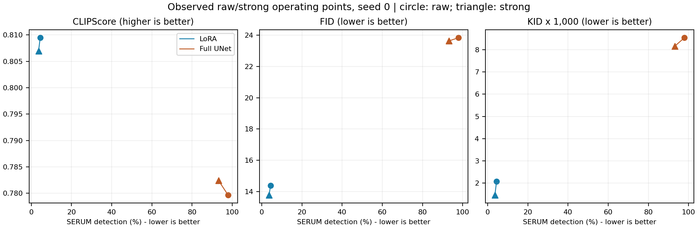

# Experimental Report: Output Laundering Before Downstream Adaptation

**Updated:** October 12, 2026, after overnight completion. **Scope:** author-artifact SERUM SD2.1 -> CtrlRegen+ -> SD1.4; one adaptation seed, raw/strong only. The four-condition LoRA queue completed at **02:17 ICT**; full-UNet C11/C10 completed at **03:59 ICT**. The original filename is retained for continuity. This report supersedes the incomplete October 11 tables and evaluates the [threat-model plan](../THREAT_MODEL_radioactive_watermark_laundering.md).

> **Implementation status:** All reported LoRA students use the corrected gradient-clipping trainer. The full branch optimizes all UNet parameters with clipping at norm 1; VAE and text encoder are frozen. Historical local-key results are summarized separately in Section 9 and are not mixed with the completed author-artifact comparisons. No claim that all remaining implementation differences have been excluded is made.

## 1. Main findings

**LoRA transfer remains weak.** Raw C10 detection is **4.42%**, compared with **2.20%** false positives for clean C00. Strong regeneration reduces C11 detection to **3.60%**: **0.82 percentage points**, or **18.55%** relative reduction. The paired 95% bootstrap CI for the reduction is **[0.22, 1.40] percentage points**. The clean-adjusted reduction is **0.52 percentage points**, CI **[-0.18, 1.20]**. This adjusted interval includes zero, so a reduction beyond the clean-control change is not clearly established. The published 52.30% LoRA baseline remains unreproduced.

**Full fine-tuning produces strong radioactive transfer.** Raw C10 detection is **97.96% (4,898/5,000)**; strong C11 remains **93.14% (4,657/5,000)**. The reduction is **4.82 percentage points**, CI **[4.10, 5.54]**, or **4.92%** relative reduction. This does not constitute radioactive collapse or meet the plan's approximately 50% moderate-success criterion. Full C00/C01 controls were not trained, so this branch has no clean-adjusted attack estimate.

Measured utility is relatively similar within each raw/strong pair: LoRA C11 CLIPScore declines **0.31%**, while full C11 increases **0.36%**. FID/KID improve in both pairs. No utility-equivalence test or systematic visual-collapse audit has been completed. Neither adaptation branch establishes a meaningful laundering attack. Strong full-branch detection is evidence that the watermark can transfer under the current implementation; it does not establish exact reproduction of the paper's training recipe or resolve the LoRA gap.

## 2. Experimental protocol and provenance

| Component | Completed experiment |
|---|---|
| Teacher and watermark | Author-provided epoch-50 SD2.1 watermark grid/detector and original cache; alpha 0.5; 512 pixels, 50 steps, CFG 7.5 |
| Student | CompVis/stable-diffusion-v1-4; common pretrained initialization |
| LoRA | Rank 4, attention q/k/v/out targets, alpha equal to rank; LR 1e-5, batch 8, 20,000 steps, seed 0, fp16 |
| Full fine-tuning | All UNet parameters; frozen VAE/text encoder; AdamW, no EMA; LR 5e-6, batch 8, 20,000 steps, seed 0, fp16 |
| Laundering | CtrlRegen+ strength 1.00; Realistic Vision V4 noVAE, semantic/Canny conditioning, color matching; 50 steps, CFG 2.0 |
| Caption handling | Fixed public-demo regeneration prompt; original captions retained for student training |
| Checkpoint selection | Minimum unseen denoising MSE on 1,000 condition-specific validation images; no detector feedback |
| Candidate cadence | LoRA every 500 steps: 40 snapshots + final; full every 1,000 steps: 20 snapshots + final |
| Student evaluation | 5,000 disjoint prompts per model; 512 pixels, PNDM, 50 steps, CFG 7.5; seed 50000 + image index |
| Detector audit | Same author detector, SD2.1 VAE and frozen threshold for all six students |

Four disjoint prompt splits contain 5,000 training, 1,000 validation, 5,000 student-evaluation and 5,000 detector-calibration prompts. The teacher corpus contains **22,000 images**, 11,000 clean and 11,000 watermarked; only the 5,000-image training subsets enter adaptation. Strong train/validation datasets contain **12,000 images** across clean/watermarked branches. The completed four LoRA and two full students produced **30,000 evaluation outputs**. Clean teacher evaluation references are excluded from training and checkpoint selection.

The author cache snapshot is `5ede9e4bf3e3fd1cb0ef2f7a3fff13ee514fdf06`. Its UNet, VAE and text-encoder tensors and tokenizer/model/scheduler files match the previously used teacher mirror. Consequently, the 11,000 clean teacher images and existing clean strong-regenerated datasets were reused after audits. C00 resumed a corrected clean checkpoint at step 8,500, including optimizer/RNG state. Other LoRA students and both full students trained fresh. Watermarked datasets were regenerated with the author key; no old-key watermarked images were reused. The reused clean and fresh watermarked branches have paired prompt IDs, but identical initial noise is not claimed.

Automated audits covered counts, RGB 512x512 decoding, hashes, source/caption pairing, seed provenance and split disjointness. Full smoke testing passed four optimizer steps at batch 8, finite weights, actual parameter updates and saved-UNet reload. These checks do not establish visual quality or replace the plan's documented manual audit of 50 image-caption pairs.

## 3. Frozen detector calibration and image-level evidence

The author-detector threshold is **tau = 0.06189660727977753**, fixed from **50/5,000 false positives (1.00%)** on held-out clean teacher images. Scoring uses the SD2.1 VAE posterior sample and scaling factor, batch 32, seed 42 with deterministic batch handling. No student-specific threshold recalibration or detector-guided checkpoint selection was used. Student-domain false-positive rates need not equal the teacher calibration FPR.

| Author teacher set | Positive / n | Detection rate |
|---|---:|---:|
| clean train | 36 / 5,000 | 0.72% |
| wm train | 5,000 / 5,000 | 100.00% |
| clean val | 15 / 1,000 | 1.50% |
| wm val | 1,000 / 1,000 | 100.00% |
| clean calib | 50 / 5,000 | 1.00% |
| wm calib | 5,000 / 5,000 | 100.00% |

The historical preservation pilot used 500 clean and 500 watermarked images. At selected strength 1.00, watermarked image TPR was **99.4%**, clean FPR **0.4%**, CLIP image cosine **0.93751**, DINOv2 cosine **0.91365**, LPIPS **0.24414**, and prompt CLIPScore retention **96.37%**. Selection used preservation bounds on both branches: CLIP >= 0.85, DINO >= 0.80, LPIPS <= 0.40, prompt-score retention >= 95%; downstream detection was excluded.

**These pilot values belong to the retired local-key configuration.** They are not measurements on the newly regenerated author-key C11 images. Therefore, high post-regeneration image-level TPR in the updated branch remains unverified. A fresh author-key image audit is required before making a Case A/B argument. Lower-strength results are excluded from this report.

## 4. Completed student detection and checkpoint selection

C00/C01 detection rates are clean-student false positives. C10/C11 detection rates are the operational TPR on outputs of watermark-trained students. Each model has 5,000 outputs. Intervals are percentile 95% bootstrap CIs from 1,000 prompt-index resamples, seed 20261012. They capture output-sampling variability within one training seed, not variation across retraining, keys or environments.

| LoRA condition | Positive / n | Detection | 95% CI | Selected step | Validation MSE |
|---|---:|---:|---:|---:|---:|
| C00 | 110 / 5,000 | 2.20% | [1.76, 2.64]% | 20,000 | 0.149788 |
| C10 | 221 / 5,000 | 4.42% | [3.86, 5.02]% | 20,000 | 0.151671 |
| C01 | 95 / 5,000 | 1.90% | [1.52, 2.28]% | 19,500 | 0.146157 |
| C11 | 180 / 5,000 | 3.60% | [3.12, 4.16]% | 20,000 | 0.146932 |

| Full condition | Positive / n | Detection | 95% CI | Selected step | Validation MSE |
|---|---:|---:|---:|---:|---:|
| Full C10 | 4898 / 5,000 | 97.96% | [97.56, 98.32]% | 20,000 | 0.121155 |
| Full C11 | 4657 / 5,000 | 93.14% | [92.42, 93.84]% | 20,000 | 0.145876 |

Validation MSE uses each condition's own unseen images with fixed cached latent/noise/timestep draws across its candidate checkpoints. Cross-condition MSE differences do not establish superiority on a common target distribution. Selection uses one noise/timestep draw per image. Full and LoRA checkpoint cadences differ; the full 20,000-step budget is an extension beyond the paper's illustrated 5,000-step SD1.4 full run, whose selected checkpoint was at 3,000. Therefore, full 97.96% is not a like-for-like reproduction of the paper's 77.12%.

## 5. Utility, paired effects and Pareto comparison

CLIPScore is `2.5 * max(cosine, 0)` using CLIP ViT-B/32. FID/KID compare with **5,000 clean SD2.1 teacher outputs on the same evaluation prompts**, not COCO. KID uses 100 subsets of 1,000 images; its reported standard deviation is variation across subsets, not an adaptation-seed CI. Final FID estimates still fall short of the plan's recommended 10,000 samples.

| Condition | CLIPScore (higher) | FID (lower) | KID x 1,000 (lower) |
|---|---:|---:|---:|
| C00 | 0.811319 | 13.520 | 1.468 ± 0.203 |
| C10 | 0.809478 | 14.378 | 2.072 ± 0.270 |
| C01 | 0.807053 | 13.043 | 1.067 ± 0.176 |
| C11 | 0.806936 | 13.773 | 1.461 ± 0.201 |
| Full C10 | 0.779636 | 23.839 | 8.539 ± 0.506 |
| Full C11 | 0.782433 | 23.631 | 8.158 ± 0.513 |

LoRA C11-C10 CLIPScore is **-0.002542**, paired CI **[-0.003960, -0.001190]**. Full C11-C10 is **0.002798**, CI **[0.001125, 0.004445]**. Clean C01-C00 is **-0.004266**, CI **[-0.005557, -0.002888]**. Small metric differences do not establish utility equivalence, capability retention or absence of visual artifacts. Both full students have worse CLIP/FID/KID than their corresponding LoRA students; increased detection does not establish improved generation utility.

For LoRA, raw detection excess above C00 is **2.22 percentage points**; strong excess above C01 is **1.70 percentage points**. The clean-adjusted reduction is therefore **0.52 percentage points**, or **23.42%** of the raw excess. The score interaction specified by the plan is `Delta = [mean D(C11)-mean D(C01)]-[mean D(C10)-mean D(C00)]`: **-0.004769**, CI **[-0.007869, -0.001725]**. Score ROC-AUC separating watermark-trained from clean-trained outputs is **0.586443** for raw and **0.563001** for strong. These are student-distribution AUCs, not teacher image ROC-AUC.

Within LoRA, raw and strong are both nondominated in detection-CLIP space: strong reduces detection but also reduces CLIPScore. Strong dominates raw in detection-FID and detection-KID point estimates. Within full fine-tuning, strong dominates raw on all three displayed metric pairs, yet detection remains **93.14%**. Pareto dominance is relative to these sampled operating points and selected metrics; it does not mean the attack meets an absolute success criterion. Only two operating points per adaptation method were evaluated, not a continuous frontier. Across methods, every LoRA watermark-trained point has lower detection and better reported utility than the full points; that comparison changes adaptation capacity and must not be interpreted as the effect of preprocessing.

## 6. Answers to the plan and attack classification

| Research question | Evidence-based answer |
|---|---|
| Does public regeneration remove the image watermark? | Historical pilot: little removal. Updated author-key regenerated images: not yet audited at image level. |
| Does raw adaptation transfer the watermark? | Yes under full UNet adaptation: 97.96% detection. LoRA shows weak transfer, 4.42% versus clean C00 2.20%; its published baseline remains unreproduced. Full clean controls are absent. |
| Does laundering substantially suppress transfer while retaining utility? | Not demonstrated. Relative detection reduction is 18.55% for weak-baseline LoRA and 4.92% for full; both fall below the plan's approximately 50% moderate-success target. |
| RQ1: detectable versus transferable watermark? | No strong separation is established. Full C11 remains highly detectable; updated post-regeneration image-level evidence is missing. |
| RQ2: key/detector-agnostic transform? | Selection excluded downstream detector feedback, but effectiveness is modest and unreplicated. |
| RQ3: mechanism of learnability? | Unresolved. The adaptation-method contrast motivates investigation; it does not isolate causal feature directions, frequencies or memorization. |
| RQ4: semantic-entanglement defense? | Untested. The current results do not justify claiming the hypothesized strong failure mode exists. |
| Cases A/B/C/D? | No meaningful A/B success is established. Metrics do not demonstrate Case C collapse. Full results lean toward D for this tested strong setting, but strict D across all utility-preserving strengths/seeds is untested. LoRA remains exploratory because its baseline is weak. |
| Model stealing or specialized capability transfer? | Not established; no specialized teacher capability beyond the base student's abilities was evaluated. |

The full branch is particularly informative: strong regeneration leaves **95.08% of raw detection rate** intact. It provides evidence against a large laundering effect at this setting. Without full C00/C01 controls, repeated seeds and an updated image-level pilot, it cannot support a general robustness claim or a clean-adjusted interaction.

## 7. Reproduction gap and limitations

The published **52.30% LoRA** and **77.12% full fine-tuning** values come from [SERUM Table 3 and Appendix I](https://adam-dziedzic.com/static/assets/papers/serum.pdf). Our LoRA C10 is **47.88 percentage points** lower. Full C10 is higher, but differs in training budget and selection cadence. Strong full transfer makes a universal failure of watermark injection/detection an inadequate explanation of the LoRA result; it does not exclude a LoRA-specific implementation or protocol discrepancy.

Main hyperparameters and author artifacts match documented choices. Remaining differences include exact training/evaluation prompt IDs and images, complete LoRA target/alpha/optimizer recipe, student dependency versions, generation details and Monte Carlo validation settings. The supplied detector/cache are public author artifacts; identity with every artifact behind the published radioactivity run is not independently established. A failed reproduction is not evidence of fabricated results.

Only one adaptation seed was run; full clean controls, an author-key preservation/image-TPR pilot, repeated seeds, score histograms/ROC plots, documented visual audits, utility-equivalence testing and specialized-capability metrics remain incomplete. Selected checkpoints are often at the 20,000-step boundary; minimum observed MSE does not demonstrate convergence or rule out memorization. The full branch's longer budget particularly requires a controlled comparison at the paper budget. Bootstrap intervals are pointwise and unadjusted for multiple comparisons.

## 8. Completed work and next steps

| Stage | Updated status |
|---|---|
| 0: image detector and C10 reproduction | Author detector/calibration and raw runs complete; LoRA radioactivity baseline unmet; full transfer strong but exact published setup not reproduced |
| 1-2: pilot and selection | Historical preservation-based strong selection complete; author-key pilot verification outstanding |
| 3: datasets | Clean reuse and fresh author-key strong C11 train/validation completed with automated audits |
| 4-5: adaptation and checkpoint selection | All four LoRA and both full students complete; full C00/C01 absent |
| 6-7: 5k outputs and common audit | Complete for six students: 30,000 outputs, common author threshold |
| 8: utility/Pareto | Metrics, paired bootstrap statistics and raw/strong figure complete; confirmatory reporting checks outstanding |
| Mechanism/defense | Not run; no strong repeatable attack established |

Priority work: (1) audit author-key regenerated teacher images for detection and preservation; (2) diagnose the LoRA reproduction gap using the original adaptation recipe and controlled, validation-selected comparisons; (3) compare full models at the paper's shorter budget and add full clean controls if clean-adjusted conclusions are required; (4) complete visual audits and final evaluation evidence. Three-seed replication and alternative operators remain needed for general claims. Defense development stays conditional on a substantial, repeatable utility-preserving attack. Section 24 remains incomplete: full adaptation is now tested for C10/C11, while SANA, other operators, dataset-size sweeps and partial laundering are not.

## 9. Evidence and historical context

Completed measurements: [four-condition LoRA summary](report_seed0_evidence/core_strong_summary.json), [full C10/C11 summary](report_seed0_evidence/full_author_summary.json), [paired statistics](report_seed0_evidence/completed_author_statistics.json), [author teacher detection](report_seed0_evidence/teacher_detection.json), and [full protocol](report_seed0_evidence/full_author_plan.json). Source provenance: [author artifact manifest](report_seed0_evidence/serum_author_manifest.json), [backbone equivalence](report_seed0_evidence/backbone_comparison.json), [C00 resume record](report_seed0_evidence/C00_resume_provenance.json), and [clipping audit](C10_CODE_AUDIT_2026-10-11.md). Score and per-image CLIP arrays accompany these summaries.

For context only, the retired local-key, pre-fix LoRA experiment measured C10 **3.24%** and strong C11 **2.54%** at a different threshold (**0.04637297987937927**). Its historical pilot and [summary](report_seed0_evidence/core_seed0_summary.json) remain archival evidence. Those numbers are not combined with the current results; differences cannot be attributed solely to clipping. Obsolete old-key images were deleted; archived metrics do not provide image-level replay of those retired runs.

Pinned sources: SERUM `02f4929e30cd976c5cfe65a45ef1bc4ac79bdfed`; CtrlRegen `6671b4b3a83f0f43e04dc1a08952b27d26197429`; Diffusers `1d5d056ecff3a8c1d887a7dd1aa66ca4a0323458`, with the documented local clipping fix and full trainer checkpoint-storage patch. Current source and environment records are under local `serum/` and server `/root/workspace/serum/manifests/`. Models/outputs/metrics use separate LoRA and full condition namespaces.

**Supported statement:** Under one author-artifact configuration, SERUM transfers strongly through full UNet fine-tuning, and strong CtrlRegen+ leaves most of that detection intact. LoRA transfer is weak and its published baseline remains unreproduced. Small raw/strong reductions and favorable utility point estimates do not establish a meaningful laundering attack or justify a general Case D claim.
